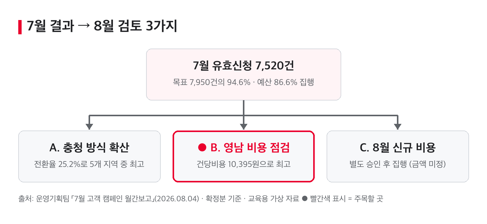

# 7월 고객 캠페인 결과 — CEO 보고

> **결론:** 7월 유효신청 7,520건(목표의 94.6%), 예산 86.6% 집행 — 영남 비용 점검 필요 `[확인]`

## 핵심 3가지
1. 유효신청 7,520건으로 목표 7,950건에 430건 못 미쳤습니다(94.6%). `[확인]`
2. 6,060만 원을 써서 승인예산 7,000만 원의 86.6%를 집행했습니다.
3. 충청은 전환율 25.2%로 가장 높고, 영남은 건당비용 10,395원으로 가장 높습니다.

## 한눈에 보기

- 7월 결과: 유효신청 7,520건, 예산 86.6% 집행
- A. 충청 상담 방식을 다른 지역에 적용할 수 있는지 확인
- **B. 영남 채널 구성(온라인·현장·기존고객 안내)과 비용 점검 ← 주목**
- C. 8월 신규 활동·콘텐츠 제작비는 별도 승인 후 집행

## 주요 숫자
| 지표 | 값 | 비교 기준 | 증감·비율 | 원문 위치 |
|---|---|---|---|---|
| 유효신청 | 7,520건 | 목표 7,950건 | ▼ −430건 (94.6%) `[확인]` | 슬라이드 5·8 |
| 집행액 | 6,060만 원 | 승인예산 7,000만 원 | 집행률 86.6% | 슬라이드 2·8 |
| 신청전환율 | 21.4% | 상담 35,150건 | — | 슬라이드 2 |
| 건당비용(전체) | 8,059원 `[확인]` | — | — | 계산: 6,060만 원 ÷ 7,520건 |

**지역별** (집행액은 부가세 제외)

| 지역 | 집행액 | 유효신청 | 목표 달성률 `[확인]` | 전환율 | 건당비용 |
|---|---|---|---|---|---|
| 수도권 | 1,650만 원 | 2,080건 | 94.5% | 19.8% | 7,933원 |
| 충청 | 1,020만 원 | 1,610건 | 97.6% | **25.2%** (최고) | 6,335원 |
| 호남 | 970만 원 | 1,300건 | 89.7% | 22.2% | 7,462원 |
| 영남 | 1,580만 원 | 1,520건 | 98.1% | 18.8% | **10,395원** (최고) |
| 강원·제주 | 840만 원 | 1,010건 | 91.8% | 23.5% | 8,317원 |
| **합계** | **6,060만 원** | **7,520건** | **94.6%** | **21.4%** | **8,059원** |

## CEO 결정·확인 필요 사항
- 이번 보고는 **보고(인지) 사항**입니다. 지금 결정할 것은 없습니다.
- 8월 신규 활동·콘텐츠 제작비는 별도로 승인을 요청할 예정입니다. 원문에 금액이 없습니다. `[확인]`

## 세부 내용
- 보고 범위: 7월 1일~31일, 8월 3일 18:00 마감 확정분, 5개 지역 · 3개 활동(온라인안내·현장상담·기존고객안내)
- 유효신청 = 신청 − 취소. 집행액은 원 단위, 부가세 제외
- 비율은 지역 합계로 계산했습니다(지역별 비율의 단순 평균 아님)
- 운영 의견: 충청의 상담 전환 성과를 참고하고, 영남의 건당비용과 채널 구성을 점검

---
**출처:** 운영기획팀 「7월 고객 캠페인 월간보고」 (2026.08.04 월간 운영회의) · 교육용 가상 자료
**확인 상태:** `[확인]` 표시 6건 — 담당자 확인 전
